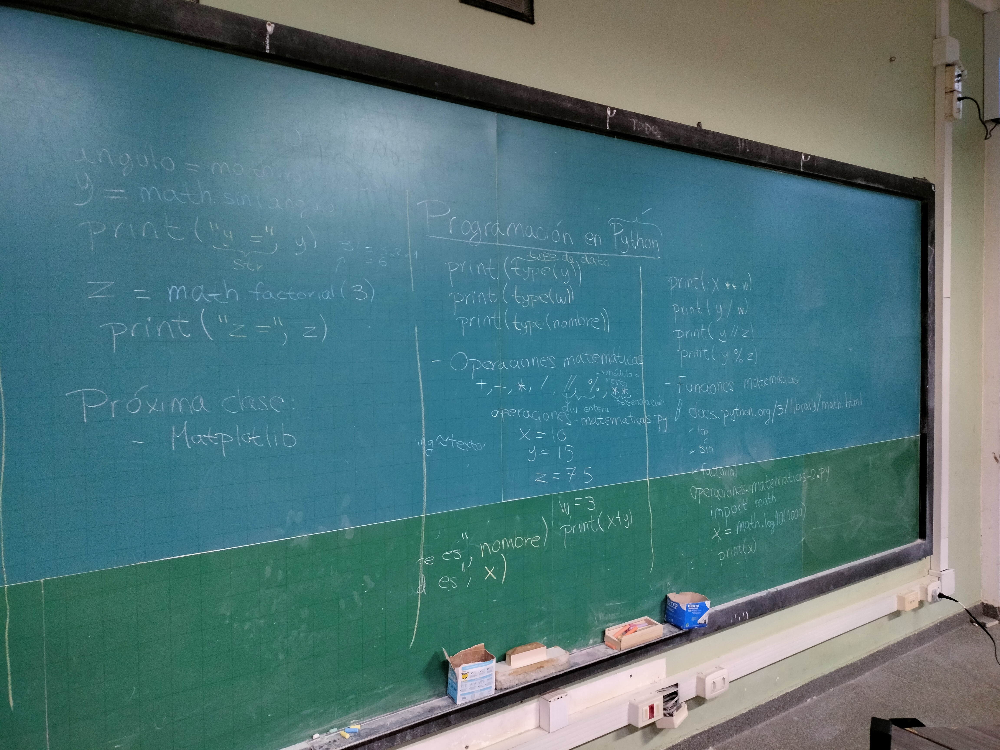

# Comparte Computación

## Sobre el proyecto

- 🎯 Objetivo: Compartir conocimientos computacionales de forma prática y didáctica
- 🧍 Público: Quien no programa nada y quien ya programa
- ✅ Requisito: Ganas de aprender y llevar 💻
- 🪙 Costo: Gratuito
- 📍 Lugar: Biblioteca del ICMC
- ⏱️ Horario: Viernes de 4:30 p. m. a 6:00 p. m.

## Temario

- Ambientes de programación
- Tipos de datos
- Variables
- Operaciones matemáticas
- Comentarios dentro de un código
